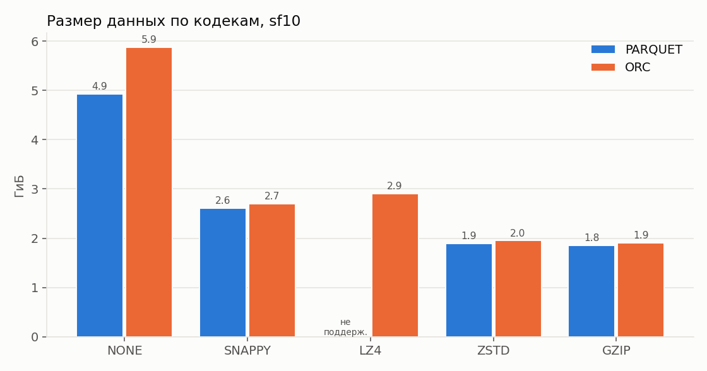
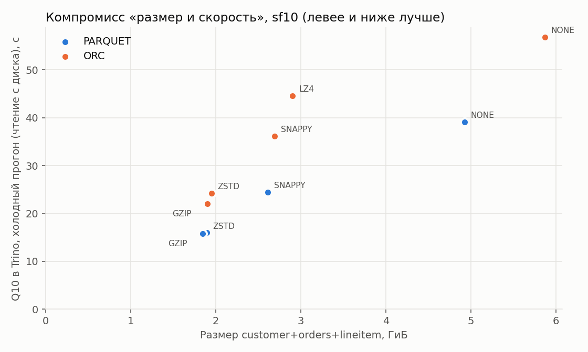
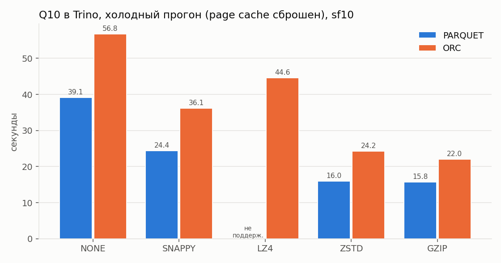
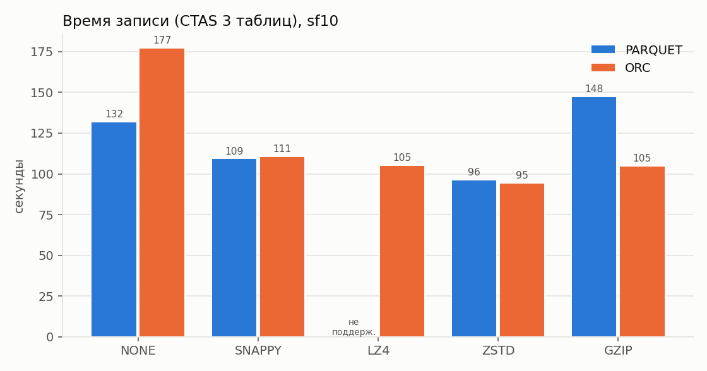
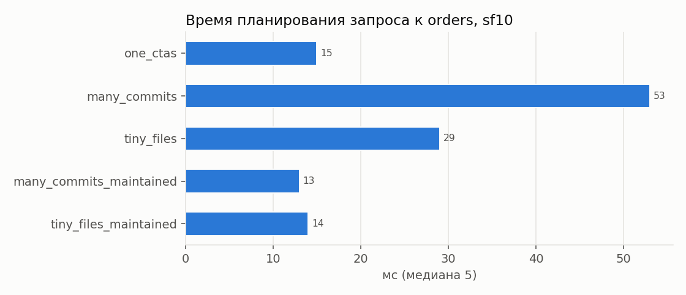
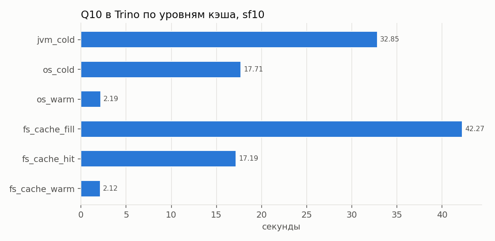

# Практическая работа p1: локальный Lakehouse, ELT по медальонной архитектуре и бенчмарк форматов и кодеков

Студент: Емельянов Александр.
Вариант 2: запрос TPC-H Q10 «Returned Item Reporting».
Курс «Основы теории информации», НИТУ МИСИС, осень 2026.

Это одновременно отчёт по форме преподавателя (разделы 1-7) и описание методологии (разделы 8-10). Сырые результаты замеров лежат в папке [results](results/), графики в папке [docs](docs/).

## 1. Вариант и масштаб

| Поле | Значение |
|---|---|
| ФИО (как в VK Education) | Емельянов Александр |
| Вариант (запрос) | Q10 «Returned Item Reporting», вариант 2 |
| Масштаб `sfN` | Медальон Bronze, Silver, Gold построен на **sf50**. Бенчмарк форматов и кодеков и опыты с метаданными и кэшем выполнены на **sf10**. Для контроля использованы sf1 (вся матрица) и sf50 (три ячейки). |
| Почему выбрал такой масштаб | В задании сказано про «большой объём данных (50 ГБ)», а `sfN` в TPC-H соответствует примерно N гигабайтам исходного текста. Для всех восьми таблиц sf50 даёт около 50 ГБ, для четырёх таблиц Q10 получается 44,5 ГиБ. Поэтому медальон я строил на sf50. На таком объёме ELT становится настоящей инженерной задачей: джойн 300 млн строк с 75 млн не поместился в память узла, и факт Silver пришлось загружать по годам. Бенчмарк я перенёс на sf10. Полная матрица на sf50 (10 комбинаций формата и кодека, два движка, три запроса, холодные и тёплые прогоны) на моём стенде заняла бы около 8 часов: один ПК, VM на 12 vCPU и 16 ГБ, данные на HDD, а одна ячейка без сжатия записывается 15 минут. На sf10 (60 млн строк `lineitem`, 5 ГБ без сжатия) стенд уже упирается в ввод-вывод. На sf1 этого нет: там разница между кодеками теряется в шуме. Коэффициенты сжатия и соотношения времени на sf10 и sf50 совпадают (раздел 5.4), значит, выводы с sf10 переносятся на sf50. Кроме того, на sf50 виден эффект, которого нет на меньших объёмах: несжатые данные перестают помещаться в память. |

## 2. Поднятые сервисы и почему именно они

Все сервисы описаны в [docker-compose.yml](docker-compose.yml), версии образов закреплены. Ниже настоящий вывод `docker ps` (колонки NAMES, IMAGE, STATUS и PORTS, дубли портов для IPv6 убраны):

```
NAMES             IMAGE                                      STATUS                       PORTS
spark             oti-spark:3.5.9-iceberg1.10.2              Up 11 hours                  0.0.0.0:4040->4040/tcp
trino             trinodb/trino:476                          Up About an hour (healthy)   0.0.0.0:8080->8080/tcp
lakekeeper        quay.io/lakekeeper/catalog:v0.14.1         Up 11 hours                  0.0.0.0:8181->8181/tcp
lakehouse-pg      postgres:17                                Up 11 hours (healthy)        0.0.0.0:5432->5432/tcp
lakehouse-minio   pgsty/minio:RELEASE.2026-08-04T00-00-00Z   Up 11 hours (healthy)        0.0.0.0:9000-9001->9000-9001/tcp
```

| Сервис | Роль в стеке | Почему именно он, а не альтернатива |
|---|---|---|
| MinIO | S3-совместимое объектное хранилище. Сюда физически записываются файлы Parquet и ORC и метаданные Iceberg. | MinIO полностью совместим с S3 API, поэтому тот же код и те же настройки без изменений заработают на AWS S3 или Yandex Object Storage. Это один бинарный файл с веб-консолью, в которой видно реальный размер таблиц (`mc du`). Официальные образы MinIO в 2025-2026 годах перестали публиковаться: quay.io и Docker Hub отвечают `unauthorized`. Поэтому я взял community-форк `pgsty/minio`, в нём тот же код и утилита `mc` внутри образа. SeaweedFS, Garage и RustFS тоже совместимы с S3, но расходятся с гайдами курса и хуже проверены в связке с Iceberg. |
| PostgreSQL | База, в которой Lakekeeper хранит метаданные каталога: какие есть пространства имён и таблицы и где лежит текущий `metadata.json` каждой таблицы. | Другой базы Lakekeeper не поддерживает. PostgreSQL обеспечивает ACID, и в нём атомарно выполняется compare-and-swap указателя на `metadata.json`. На этой операции держится транзакционность Iceberg (лекция «Табличные форматы»). |
| Lakekeeper | Iceberg REST Catalog, то есть каталог метаданных таблиц. Для каждого слоя заведён свой warehouse (`bronze`, `silver`, `gold`), и у каждого свой бакет. | Открытый и лёгкий REST-каталог на Rust с веб-интерфейсом и API для управления. REST-протокол Iceberg понимают и Trino, и Spark, поэтому один каталог обслуживает оба движка, и я этим воспользовался. Hive Metastore тяжелее, работает через Thrift, а переименование в S3 у него не атомарно. Nessie хорош для ветвления в духе git, но здесь оно не требуется. |
| Trino | SQL-движок. Берёт метаданные у Lakekeeper, читает и пишет данные в MinIO. На нём выполнены весь ELT (CTAS и INSERT) и бенчмарк. | Это MPP-движок с коннекторами к Iceberg и `tpch`: генератор TPC-H встроен, и ничего скачивать не нужно. Trino работает с Parquet и ORC, умеет pushdown и pruning и отдаёт точную статистику по каждому запросу (`elapsedTime`, `cpuTime`, `physicalInputBytes`). В нём есть файловый кэш (`fs.cache`), который понадобился для опыта с кэшированием. |
| Spark 3.5.9 с Iceberg 1.10.2 | Второй движок: выполняет те же запросы по тем же Iceberg-таблицам и работает со слоем Bronze по пункту 6.2. | Задание прямо требует сравнить «агрегации в Spark/Trino». Spark считается стандартным движком для пакетного ELT и машинного обучения, а Parquet для него родной формат (лекция 6). Spark подключается к тому же Lakekeeper и читает данные без копирования. Это и есть разделение вычислений и хранения. |

### Скрипты, которыми поднимал стек

```bash
docker compose up -d                                  # MinIO, PostgreSQL, Lakekeeper (migrate и serve), Trino
docker compose --profile spark --profile tools build  # образ Spark (Iceberg runtime и AWS bundle) и образ tools (pyarrow, matplotlib)
docker compose --profile spark up -d spark            # Spark как второй движок
bash scripts/init_lakehouse.sh                        # бакеты bronze, silver, gold, bootstrap, три warehouse и схемы
```

Скрипт `scripts/init_lakehouse.sh` повторяет шаги из гайдов 1 и 2, только через API, а не через веб-интерфейс:
* `mc mb` создаёт бакеты `bronze`, `silver` и `gold` (утилита `mc` запускается внутри контейнера MinIO);
* `POST /management/v1/bootstrap` принимает условия использования;
* `POST /management/v1/warehouse` вызывается три раза, по одному warehouse на слой. В качестве endpoint указан `http://minio:9000`, потому что все сервисы в одной docker-сети и `host.docker.internal` не нужен. Профиль удаления `hard`: при DROP файлы удаляются сразу, это я проверил по размеру бакета;
* `CREATE SCHEMA` создаёт схемы `bronze.lakehouse`, `silver.lakehouse` и `gold.lakehouse`.

Каталоги Trino лежат в [trino/catalog](trino/catalog/). Каталоги `bronze`, `silver` и `gold` настроены по гайду 2, `tpch` подключает генератор, а `bronze_cached` смотрит на тот же warehouse bronze, но с включённым `fs.cache.enabled=true` для опыта с кэшем.

## 3. Разбор запроса: какие данные нужны

| Таблица TPC-H | Нужные колонки | Что запрос с ними делает (фильтр, джойн, агрегат, вывод) |
|---|---|---|
| `lineitem` (300 млн строк на sf50) | `orderkey`, `returnflag`, `extendedprice`, `discount` | Джойн с `orders` по `orderkey`, фильтр `returnflag = 'R'`, агрегат `sum(extendedprice * (1 - discount))`, то есть выручка. |
| `orders` (75 млн строк) | `orderkey`, `custkey`, `orderdate` | Джойн с `lineitem` и `customer`, фильтр по `orderdate`: четвёртый квартал 1993 года (`>= 1993-10-01 AND < 1994-01-01`). |
| `customer` (7,5 млн строк) | `custkey`, `name`, `acctbal`, `address`, `phone`, `comment`, `nationkey` | Джойн с `orders` по `custkey` и с `nation` по `nationkey`, ключи группировки и вывод. |
| `nation` (25 строк) | `nationkey`, `name` | Джойн по `nationkey` и вывод страны клиента. |

В итоге запрос группирует строки по клиенту и выводит первые 20 клиентов по выручке от возвращённых позиций за квартал (`ORDER BY revenue DESC LIMIT 20`). Самая тяжёлая операция здесь это джойн `lineitem` с `orders`, поэтому я выполняю его заранее, в слое Silver.

## 4. Медальон: решения по каждому слою

SQL для слоёв: [01_bronze.sql](sql/01_bronze.sql), [02_silver.sql](sql/02_silver.sql), [03_gold.sql](sql/03_gold.sql). Запускает их [bench/pipeline.py](bench/pipeline.py). Все цифры ниже получены на sf50. Вес таблицы считается как `sum(file_size_in_bytes)` по `"<таблица>$files"`, он совпадает с тем, что показывает `mc du` для бакета.

### Bronze (сырые данные)

Для всех таблиц Bronze решения общие.
* Колонки: все колонки источника плюс служебные `_source` и `_loaded_at`. Bronze служит источником истины, из него можно пересчитать любую будущую витрину, поэтому я ничего не отбрасываю. Служебные поля фиксируют, откуда и когда пришли данные (лекция 4, слайды 16, 17 и 20).
* Формат: PARQUET.
* Сжатие: ZSTD.
* Партиционирование: нет. Загрузка была одна, и партиция по дате загрузки получилась бы единственной. Q10 фильтрует по `orderdate`, и этим занимается Silver.

| Таблица | Строк | Вес, МБ | Время записи, с | Обоснование |
|---|---:|---:|---:|---|
| `raw_lineitem` | 300 005 811 | 7 766 | 232 | Самая большая таблица, около 80 % объёма. ZSTD выбран по результатам замеров (раздел 5): он почти так же компактен, как GZIP, но заметно дешевле по CPU и при записи, и при чтении. Bronze перечитывается при каждом пересчёте Silver, так что скорость чтения здесь тоже важна. |
| `raw_orders` | 75 000 000 | 1 875 | 64 | Решения те же. |
| `raw_customer` | 7 500 000 | 389 | 18 | Решения те же. |
| `raw_nation` | 25 | 0,002 | 10 | Справочник, у которого футер больше самих данных. Отдельные решения не нужны. |

### Silver (очищенные данные)

| Таблица | Колонки (что оставил) | Строк | Вес, МБ | Формат | Сжатие | Партиционирование | Обоснование |
|---|---|---:|---:|---|---|---|---|
| `dim_customer` | `custkey`, `name`, `address`, `phone`, `phone_country_code`, `acctbal`, `mktsegment`, `comment`, `nationkey`, `nation_name`, `regionkey`, `bronze_loaded_at` | 7 500 000 | 413 | PARQUET | ZSTD | нет | Очистка: дедупликация по `custkey` (через `row_number` по `_loaded_at`, на случай повторной загрузки Bronze) и `trim` строк. Нормализация: `acctbal` переведён из `double` в `decimal(12,2)`, потому что деньги в числах с плавающей точкой дают ошибки округления, а категории приведены к верхнему регистру. Обогащение: добавлены страна из `nation` и код страны из телефона. Таблица небольшая и в джойне читается целиком, так что партиции дали бы только лишние мелкие файлы. |
| `fact_order_line` | `orderkey`, `linenumber`, `custkey`, `orderdate`, `orderstatus`, `returnflag`, `linestatus`, `quantity`, `extendedprice`, `discount`, `tax`, `net_revenue`, `shipdate`, `receiptdate` | 300 005 811 | 4 255 | PARQUET | ZSTD | `month(orderdate)`, сортировка `returnflag, custkey` | Факт «позиция заказа» получен джойном `lineitem` с `orders`. Дорогой джойн выполняется здесь один раз, а не в каждом отчёте. Выручка `net_revenue = extendedprice * (1 - discount)` посчитана заранее в `decimal(18,4)`. Из `lineitem` взяты 10 колонок из 16, отброшены `partkey`, `suppkey`, `commitdate`, `shipinstruct`, `shipmode` и самая тяжёлая `comment`, на которую приходится около трети сжатого объёма. Поэтому факт на 45 % легче `lineitem` в Bronze при тех же 300 млн строк. В Silver хранятся все периоды, а не только четвёртый квартал 1993 года: так слой можно использовать повторно, а конкретный квартал выбирает Gold. Благодаря партициям по месяцу фильтр по кварталу читает 3 партиции из 80. Сортировка по `returnflag` делает диапазоны min/max в row group'ах узкими, и фильтр `= 'R'` пропускает лишние row group'ы. Данные загружены семью INSERT, по одному на год заказа: один CTAS на sf50 не помещался в память (хэш-таблица по 75 млн заказов занимала около 3 ГБ, плюс буферы 80 партиций). Каждый год стал отдельным снапшотом, всего их 8. |
| `dq_report` | `rule`, `failed_rows` | 6 | 0,004 | PARQUET | ZSTD | нет | Проверки качества, во всех шести правилах 0 нарушений. Проверяются дубли `custkey`, позиции без заказа, `discount` вне диапазона от 0 до 1 или отрицательная цена, клиенты без страны, несовпадение кода телефона с `nationkey + 10` (так устроен генератор TPC-H) и потеря строк при переходе из Bronze в Silver. |

### Gold (витрина)

| Таблица | Колонки | Строк | Вес, МБ | Формат | Сжатие | Партиционирование | Обоснование |
|---|---|---:|---:|---|---|---|---|
| `returned_revenue_by_customer_quarter` | `custkey`, `order_quarter`, `returned_revenue`, `returned_lines` | 25 432 805 | 297 | PARQUET | SNAPPY | `year(order_quarter)` | Витрина для BI: потери от возвратов по каждому клиенту за любой квартал. Если дашборду понадобится 1995 год, Silver пересчитывать не придётся. Gold читают чаще всех остальных слоёв, поэтому выбран кодек «на скорость» (лекция 7, слайд 26 советует Snappy для Gold). Партиции по году соответствуют типичному фильтру дашборда. |
| `q10_top20_returned_customers` | `custkey`, `name`, `revenue`, `acctbal`, `nation`, `address`, `phone`, `comment` | 20 | 0,004 | PARQUET | SNAPPY | нет | Точный ответ на запрос варианта. Для сверки ([04_validate.sql](sql/04_validate.sql)) исходный SQL Q10 из файла вариантов запускается прямо по `tpch.sf50`, и набор пар `(custkey, revenue)` совпадает, расхождений нет. Сверка длится 287 с, но почти всё это время уходит на повторную генерацию данных TPC-H. Это цена проверки, а не время самого запроса. |

Первые три строки результата Q10 на sf50:

| custkey | name | revenue | nation |
|---:|---|---:|---|
| 3872296 | Customer#003872296 | 907 520,63 | JORDAN |
| 6581440 | Customer#006581440 | 821 712,72 | ALGERIA |
| 533257 | Customer#000533257 | 819 958,20 | FRANCE |

Построение слоёв на sf50 заняло: Bronze 324 с (вместе с генерацией из `tpch`), Silver 695 с, Gold 54 с.

**Что даёт каждый слой.** Один и тот же ответ Q10 на sf50 я посчитал тремя способами ([bench/medallion_exp.py](bench/medallion_exp.py), результат в [results/medallion_sf50.json](results/medallion_sf50.json)): один холодный прогон после сброса page cache и медиана пяти тёплых.

| Откуда считается Q10 | Холодный прогон, с | Прочитано с диска, МБ | Тёплый прогон, с | CPU тёплого прогона, с |
|---|---:|---:|---:|---:|
| Bronze, джойн четырёх таблиц `raw_*` | 84,7 | 2 339 | 7,40 | 47,5 |
| Silver, джойн `fact_order_line` и `dim_customer` | 14,5 | 462 | 2,58 | 12,4 |
| Gold, готовая таблица `q10_top20_returned_customers` | 0,24 | около 0 | 0,04 | 0,0 |

По Silver запрос выполняется в 5,8 раза быстрее, чем по Bronze, на холодную и в 2,9 раза быстрее на тёплую, а CPU тратится в 3,8 раза меньше. Причины в том, что джойн `lineitem` с `orders` уже выполнен, фильтр по кварталу читает 3 партиции из 80 и колонок вдвое меньше, так что с диска читается в 5 раз меньше данных. Gold отдаёт готовые 20 строк за десятки миллисекунд, как бы часто ни обновлялся дашборд.

## 5. Тесты производительности

Код бенчмарка лежит в [bench/benchmark.py](bench/benchmark.py), методика описана в [разделе 8](#8-методология-бенчмарка). Полные таблицы: [summary_sf10.md](results/summary_sf10.md) для основного масштаба, а также [summary_sf1.md](results/summary_sf1.md) и [summary_sf50.md](results/summary_sf50.md). Кодек каждой ячейки проверен по футерам файлов (колонка «Кодек в файле» в сводках).

### 5.1. Таблица из формы: кодек для Bronze (PARQUET, sf10, таблицы `customer`, `orders` и `lineitem`)

| Сжатие на Bronze | Время запроса Q10 в Trino: тёплый и холодный прогон | Размер Bronze, МБ | Вывод: что лучше и почему |
|---|---|---:|---|
| GZIP | 2,33 с и 15,8 с | 1 894 | Самый компактный вариант: данные занимают в 4,81 раза меньше исходного текста. Но запись стоит в 1,9 раза больше CPU (444 с против 237 с) и идёт дольше всех среди Parquet (148 с). Распаковка тоже дороже: CPU тёплого Q10 9,5 с против 8,4 с у ZSTD, на `agg_scan` 7,6 с против 6,1 с. При этом места GZIP экономит по сравнению с ZSTD всего 2,4 %. |
| ZSTD | 2,10 с и 16,0 с | 1 941 | Лучший баланс, его я и выбрал для Bronze. Размер почти как у GZIP, а запись самая быстрая (96 с). Она быстрее даже записи без сжатия, потому что на HDD экономия ввода-вывода перекрывает затраты CPU. Холодный Q10 такой же, как у GZIP, тёплый быстрее. Для сравнения: без сжатия данные занимают 5 042 МБ и холодный Q10 идёт 39,1 с, со SNAPPY 2 677 МБ и 24,4 с. |

На моём стенде ZSTD выигрывает у GZIP: размер практически тот же, а CPU на запись и чтение уходит меньше. Лекция 7 советует GZIP для Bronze, потому что этот слой «пишется редко и должен сжиматься максимально». Такой выбор оправдан, только если хранение стоит несравнимо дороже процессорного времени. У меня разница в месте составила 2,4 %, а в CPU на запись почти вдвое.

### 5.2. Полная матрица на sf10 (Trino, кодеки NONE, SNAPPY, LZ4, ZSTD и GZIP для PARQUET и ORC)

| Формат | Кодек | Размер, МБ | Сжатие относительно NONE, раз | Запись, с | CPU записи, с | Q10 тёплый | Q10 холодный | Q10 прочитано, МБ | agg_scan тёплый | agg_scan холодный |
|---|---|---:|---:|---:|---:|---:|---:|---:|---:|---:|
| PARQUET | NONE | 5 042 | 1,00 | 132 | 198 | 2,01 | 39,1 | 1 417 | 0,80 | 16,2 |
| PARQUET | SNAPPY | 2 677 | 1,88 | 109 | 228 | 2,15 | 24,4 | 741 | 0,83 | 11,8 |
| PARQUET | LZ4 | н/д | н/д | н/д | н/д | н/д | н/д | н/д | н/д | н/д |
| PARQUET | ZSTD | 1 941 | 2,60 | 96 | 237 | 2,10 | 16,0 | 467 | 0,80 | 9,8 |
| PARQUET | GZIP | 1 894 | 2,66 | 148 | 444 | 2,33 | 15,8 | 469 | 0,93 | 10,2 |
| ORC | NONE | 6 011 | 1,00 | 178 | 224 | 2,02 | 56,8 | 1 371 | 1,98 | 55,5 |
| ORC | SNAPPY | 2 759 | 2,18 | 111 | 239 | 1,97 | 36,1 | 723 | 1,80 | 32,6 |
| ORC | LZ4 | 2 974 | 2,02 | 105 | 223 | 1,79 | 44,6 | 768 | 1,50 | 33,2 |
| ORC | ZSTD | 1 997 | 3,01 | 95 | 239 | 1,94 | 24,3 | 525 | 1,57 | 22,3 |
| ORC | GZIP (ZLIB) | 1 946 | 3,09 | 105 | 311 | 2,19 | 22,0 | 510 | 1,71 | 20,9 |

Комбинацию Parquet и LZ4 Trino 476 не поддерживает (`NOT_SUPPORTED: Compression codec LZ4 not supported for Parquet`), и это тоже результат. Время указано в секундах. Тёплое время считается как медиана пяти прогонов. Холодный прогон на ячейку один, сразу после сброса page cache, потому что холодное состояние можно получить только один раз. Разброс тёплых прогонов от минимума до максимума сохранён в `results/bench_sf10.jsonl`.






Что видно из цифр.
1. Время тёплого прогона почти не зависит от кодека. Q10 во всех ячейках занимает от 1,8 до 2,3 с: данные уже лежат в page cache, и всё упирается в CPU джойна. Распаковка добавляет CPU, и сколько именно, зависит от кодека. На Q10 по сравнению с NONE SNAPPY добавляет 15 %, ZSTD 14 %, GZIP 28 % (7,4 с без сжатия против 8,5, 8,4 и 9,5 с). На `agg_scan` прибавка больше: 18 %, 20 % и 49 % (5,1 с против 6,0, 6,1 и 7,6 с). Холодный прогон с HDD растёт почти пропорционально прочитанным байтам: 39 с без сжатия, 24 с со SNAPPY и 16 с с ZSTD или GZIP. Сжатие окупается там, где узкое место во вводе-выводе. В облаке, где S3 читается по сети, это обычная ситуация.
2. Сжатие ускоряет запись. С ZSTD данные записываются быстрее, чем без сжатия: 96 с против 132 с для Parquet и 95 с против 178 с для ORC. На медленный диск уходит меньше байт. Это ровно то, о чём говорится на слайде 19 лекции 7.
3. Работают column pruning и predicate pushdown. Q10 прочитал 467 МБ из 1 941 МБ (24 %), `agg_narrow` прочитал 331 МБ. Читаются только нужные колонки, а row group'ы отсекаются по min/max.
4. Parquet против ORC. Относительно своего варианта без сжатия ORC сжимается чуть сильнее (в 3,01 раза против 2,60 у Parquet с ZSTD), но по абсолютному размеру файлы почти одинаковы. При этом Trino читает ORC заметно медленнее: тёплый `agg_scan` 1,57 с против 0,80 с, холодный 22 с против 10 с. В Spark ORC тоже проигрывает: `agg_narrow` занимает 4,6-5,1 с против 0,5-0,6 с. Это подтверждает вывод лекции 6: Parquet является форматом лейкхауса, а ORC пришёл из мира Hive.
5. Метаданные внутри файлов почти ничего не весят, футеры занимают от 0,0005 до 0,002 % объёма. У ORC футеры втрое меньше, чем у Parquet (8,5 КБ против 28 КБ при ZSTD), потому что ORC сжимает и свои метаданные (лекция 7, слайд 29). Зато Parquet хранит min/max каждого колоночного чанка прямо в футере, и их можно прочитать одним обращением к концу файла.

### 5.3. Spark и Trino на одних и тех же Iceberg-таблицах (sf10)

| Формат и кодек | Q10 в Trino, тёплый | Q10 в Spark, тёплый | agg_scan в Trino | agg_scan в Spark |
|---|---:|---:|---:|---:|
| PARQUET, ZSTD | 2,10 с | 14,5 с | 0,80 с | 1,52 с |
| PARQUET, GZIP | 2,33 с | 7,6 с | 0,93 с | 1,74 с |
| ORC, ZSTD | 1,94 с | 12,5 с | 1,57 с | 6,00 с |

На Q10 Spark работает в 3-7 раз медленнее Trino. Чтобы понять почему, я посмотрел физический план ([spark/jobs/explain_q10.py](spark/jobs/explain_q10.py)). Spark выбрал 4 SortMergeJoin и 12 операций Exchange (shuffle): он целиком сортирует и перетасовывает `customer` и `orders`. Trino строит hash join и с помощью динамического фильтра отсекает лишние строки `lineitem` ещё до чтения. Тёплые прогоны в Spark к тому же нестабильны (Q10 от 7,6 до 15 с в разных ячейках), потому что в локальном режиме с драйвером на 5 ГБ много времени уходит на сборку мусора. Простые агрегации Spark выполняет примерно так же быстро, как Trino. Вывод: для интерактивных запросов с джойнами к лейкхаусу лучше подходит Trino, а Spark стоит использовать для пакетного ELT и машинного обучения.

### 5.4. Влияние объёма данных: sf1, sf10 и sf50

| Масштаб | Размер Parquet без сжатия и со SNAPPY | Q10 тёплый: NONE и SNAPPY | Q10 холодный: NONE, SNAPPY и ZSTD |
|---|---|---|---|
| sf1 | 485 и 262 МБ (сжатие в 1,85 раза) | 0,65 и 0,58 с | 7,8, 4,6 и 5,4 с |
| sf10 | 5 042 и 2 677 МБ (в 1,88 раза) | 2,01 и 2,15 с | 39,1, 24,4 и 16,0 с |
| sf50 | 26 755 и 14 202 МБ (в 1,88 раза) | **94,7 и 6,8 с** | 183, 111 и 76 с |

* Условия на разных масштабах немного отличаются. sf1 измерялся в VM на 20 ГБ с heap Trino 10 ГБ, без spill и с параллелизмом записи по умолчанию. sf10 и sf50 измерялись в VM на 16 ГБ с heap 8 ГБ и записью в 6 драйверов и 4 writer'а (подробнее в разделе 9). Поэтому я сравниваю соотношения внутри одного масштаба, а не абсолютные секунды на разных масштабах.
* На sf1 разница между кодеками теряется в постоянных накладных расходах: планирование, JIT, обращения к MinIO. Делать выводы о кодеках на таком объёме нельзя.
* Коэффициент сжатия от масштаба не зависит (1,88), и отношение холодного времени SNAPPY к ZSTD тоже стабильно: 1,53 на sf10 и 1,47 на sf50. Значит, выводы, полученные на sf10, справедливы и для sf50.
* Главный эффект большого объёма в том, что на sf50 несжатые данные (26,7 ГБ) не помещаются в page cache VM на 16 ГБ. Поэтому даже «тёплый» Q10 каждый раз читает HDD и идёт 94,7 с против 6,8 с со SNAPPY. Это подтверждается расчётом. Без сжатия Q10 читает 6,9 ГиБ колонок за запрос. Из 16 ГБ памяти VM 8 ГБ занимает heap Trino, ещё около 1,5 ГБ уходит на служебную память JVM, MinIO, Lakekeeper и PostgreSQL, так что для page cache остаётся примерно 6 ГиБ, а это меньше 6,9 ГиБ. Рабочий набор со SNAPPY (3,6 ГиБ) помещается. Получается, что сжатие экономит не только место на диске, но и решает, поместится ли рабочий набор в память.

Ячейка PARQUET с ZSTD на sf50 посчитана в Trino: холодный Q10 75,5 с, тёплый 6,8 с, прочитано 2 341 МБ (см. `results/run_all.log`). Шаг со Spark в этой ячейке один раз завершился сбоем, а при повторном ручном запуске прошёл, и Q10 занял 162 с. После этого бенчмарк был перенесён на sf10.

### 5.5. Объём метаданных: мелкие файлы и много снапшотов (sf10, таблица `orders` на 15 млн строк)

| Вариант | Файлов | Средний файл | Манифестов | Снапшотов | `metadata/`, МБ | Планирование: холодное и тёплое | Запрос: холодный и тёплый |
|---|---:|---:|---:|---:|---:|---:|---:|
| Один CTAS | 12 | 31 МБ | 1 | 1 | 0,19 | 14 и 15 мс | 5,2 и 0,16 с |
| 80 INSERT (микробатчи) | 80 | 4,6 МБ | 80 | 81 | **16,3** | **530 и 53 мс** | 1,7 и 0,13 с |
| CTAS с `target_max_file_size=2MB` | **920** | 435 КБ | 1 | 1 | 0,28 | 22 и 29 мс | **32,4 и 0,63 с** |
| 80 INSERT, затем обслуживание | 1 | 377 МБ | 1 | 1 | 1,8 | 14 и 13 мс | 3,9 и 0,13 с |
| 920 файлов, затем обслуживание | 1 | 369 МБ | 1 | 1 | 0,02 | 13 и 14 мс | 3,0 и 0,17 с |

Обслуживание включает `optimize`, `optimize_manifests`, `expire_snapshots` и `remove_orphan_files` и занимает 32-47 с.



* Много снапшотов раздувают метаданные в 85 раз (16,3 МБ против 0,19 МБ) и замедляют планирование: в 38 раз на холодную (530 мс) и в 3,5 раза на тёплую. Планировщику приходится читать и разбирать 80 манифестов. Сам запрос при этом выполняется даже быстрее (1,7 с). Каждый INSERT записывал один месяц, поэтому файлы получились упорядоченными по `orderdate`, и фильтр по полугодию отсекает лишние файлы по min/max (CPU 0,04 с против 0,47 с). Отсюда побочный вывод: то, как данные разложены по ключу фильтра, важнее числа файлов.
* Мелкие файлы (920 файлов по 435 КБ) хуже всего сказываются на чтении. Холодный запрос идёт в 6 раз медленнее (32 с против 5 с), потому что на HDD каждый файл означает отдельное позиционирование головки. Тёплый запрос медленнее в 4 раза, CPU уходит в 5,7 раза больше: каждый файл нужно открыть, прочитать его футер и создать для него отдельный сплит.
* Обслуживание таблицы возвращает всё к норме. После `optimize` и `expire_snapshots` остаются один файл, один манифест и один снапшот, а планирование снова занимает 13-14 мс. В `metadata/` остаётся 1,8 МБ старых файлов `metadata.json`, потому что Iceberg хранит историю версий в пределах `write.metadata.previous-versions-max`.

### 5.6. Кэширование (sf10, Q10 по источнику Bronze)

| Уровень кэша | Q10, с | CPU, с | `agg_scan`, с |
|---|---:|---:|---:|
| Холодная JVM: перезапуск Trino и сброс page cache | 32,9 | 15,2 | 27,0 |
| Page cache ОС сброшен, Trino прогрет | 17,7 | 7,2 | 13,4 |
| Page cache ОС прогрет (медиана 5) | **2,2** | 8,4 | **1,0** |
| Файловый кэш Trino: заполнение | 42,3 | 14,3 | 33,8 |
| Файловый кэш Trino: попадание при сброшенном page cache | 17,2 | 7,0 | 10,9 |
| Файловый кэш Trino и прогретый page cache (медиана 5) | 2,1 | 8,0 | 0,9 |
| Spark без кэша и с `CACHE TABLE` (медиана 3) | 10,1 и **49,8** | н/д | 1,7 и **9,2** |



* Сильнее всего помогает page cache ОС: Q10 ускоряется в 8 раз, `agg_scan` в 13 раз. Чем компактнее кодек, тем большая часть данных в него помещается (см. sf50 в разделе 5.4).
* Холодная JVM добавляет ещё около 15 с: JIT-компиляция, пустые кэши метаданных Iceberg и заново открываемые соединения с Lakekeeper и MinIO. Практический вывод: долгоживущий кластер выгоднее, чем кластер, который поднимается под один запрос.
* Файловый кэш Trino на этом стенде почти ничего не дал (17,2 с против 17,7 с). Дело в устройстве стенда: каталог кэша лежит на том же HDD, что и MinIO, так что попадание в кэш означает то же чтение с того же диска, только без HTTP-запроса к MinIO. Первое заполнение к тому же дороже: 42,3 с против 32,9 с у холодной JVM, на 29 % больше, потому что данные ещё и записываются в кэш. Такой кэш окупается, когда сам он лежит на быстром локальном NVMe, а данные приходят из удалённого S3 по сети. Именно для этого он и нужен в облаке.
* `CACHE TABLE` в Spark замедлил запросы в 5 раз. В кэш попали три таблицы, включая `lineitem` на 60 млн строк, а память под кэш (MemoryStore) у драйвера на 5 ГБ составляет всего 2,8 ГиБ, это видно в логе Spark. При повторной проверке тот же сценарий упал с ошибкой `java.lang.OutOfMemoryError: Java heap space`, то есть кэш просто не помещается в память. Вероятно, есть и вторая причина: запрос к закэшированной таблице читает её из памяти целиком, без передачи фильтров в Iceberg. Кэшировать имеет смысл небольшие часто используемые таблицы, а не большой факт.

### 5.7. Соотношение размера, скорости и стоимости

Модель расчёта: хранение стоит $0,023 за ГБ в месяц, свой кластер это ВМ на 16 vCPU за $0,768 в час, serverless-движок берёт $5 за прочитанный ТБ. Нагрузка: по 1000 запросов Q10 и `agg_scan` в месяц на sf10. Все допущения заданы параметрами в [bench/analyze.py](bench/analyze.py).

| Parquet с кодеком | Хранение, $ в месяц | Своя ВМ, $ в месяц | Serverless, $ в месяц |
|---|---:|---:|---:|
| NONE | 0,113 | 0,60 | 9,95 |
| SNAPPY | 0,060 | 0,64 | 5,97 |
| ZSTD | **0,044** | 0,62 | **4,21** |
| GZIP | 0,043 | 0,70 | 4,16 |

* На serverless-движке, который берёт деньги за прочитанные байты (Athena или Trino как сервис), ZSTD обходится на 58 % дешевле, чем данные без сжатия. Здесь выбор кодека напрямую экономит деньги.
* На своём кластере время тёплых запросов почти не зависит от кодека, а GZIP даже дороже на 13 % из-за затрат CPU. Хранение на таком объёме стоит копейки, но растёт линейно: каждый снапшот и каждый слой медальона означают ещё одну копию данных (лекция 7, слайд 9).
* В итоге ZSTD выигрывает во всех трёх статьях расходов или почти не уступает. GZIP выгоден только для холодного архива, который почти не читают. SNAPPY разумен там, где не хватает CPU, а место не важно.

## 6. Часть 2: осмысление и работа с инструментами

### 6.1. Понять и объяснить

| Вопрос | Ответ |
|---|---|
| Зачем нужны большие данные и lakehouse, а не обычная БД или хранилище? | Обычная OLTP-база вроде PostgreSQL хранит данные строками на локальном диске одного сервера. Агрегация по 300 млн строк в ней читает все колонки всех строк и не масштабируется за пределы одной машины. Классическое хранилище данных (Greenplum, Teradata) справляется с аналитикой, но держит данные в закрытом формате на дисках своих узлов: вычисления и хранение связаны, и платить приходится за то и другое, даже когда ничего не считается. Озеро данных дёшево, потому что использует объектное хранилище, но без транзакций и схемы быстро превращается в «болото». Lakehouse объединяет дешёвое объектное хранилище (MinIO или S3), открытый колоночный формат (Parquet), табличный формат с ACID, снапшотами и эволюцией схемы (Iceberg) и отдельные от хранения движки (Trino, Spark), которые читают одни и те же файлы. В этой работе это видно на практике. Таблицу Bronze, которую записал Trino, Spark читает без всякого копирования (пункт 6.2). Bronze на sf50 занимает 10 ГБ, хотя те же четыре таблицы в текстовом виде весят 44,5 ГиБ, в 4,5 раза больше. Для Q10 колоночный формат читает только 24 % файла. Движки можно запускать и останавливать независимо от данных. |
| Пример эволюции схемы на Silver: добавил или переименовал колонку, что произошло? | Скрипт: [bench/demos.py](bench/demos.py), полный вывод: [results/demo_schema_evolution.txt](results/demo_schema_evolution.txt). Опыт проводился на таблице `silver.lakehouse.dim_customer` (7,5 млн строк). Сначала я выполнил `ADD COLUMN customer_tier varchar`, и это произошло мгновенно. Меняются только метаданные: в `metadata.json` появляется новый `schema-id`, а файлы Parquet не переписываются. В старых файлах этой колонки нет, и при чтении она возвращает `NULL`. Затем я заполнил колонку через `UPDATE ... SET customer_tier = CASE ...`: получилось 3,41 млн клиентов GOLD, 3,41 млн STANDARD и 0,68 млн DEBTOR. Iceberg v2 выполняет обновление в режиме merge-on-read: появился снапшот `overwrite` с delete-файлами, и в его сводке `total-records` стало 15 млн, потому что учтены и старые строки, и их новые версии. Потом я переименовал колонку (`RENAME COLUMN phone_country_code TO phone_cc`), и это тоже заняло мгновение. Iceberg обращается к колонкам по field-id, а не по имени, поэтому данные трогать не нужно. В Hive или в «голом» Parquet такое переименование сломало бы чтение старых файлов. Наконец, time travel видит старую схему: `SELECT * ... FOR VERSION AS OF 4200283017854022894` возвращает строки без `customer_tier` и с прежним названием `phone_country_code`, потому что снапшот помнит свой `schema-id`. После опыта я вернул схему и откатил данные через `rollback_to_snapshot` к исходному снапшоту, так что Silver снова соответствует пайплайну. |
| Пример скрипта восстановления данных из снапшота (time travel) | Полный вывод: [results/demo_time_travel.txt](results/demo_time_travel.txt). Сценарий: в Gold по ошибке выполнили DELETE. |

```sql
-- 1. Запоминаем последний «хороший» снапшот витрины
SELECT snapshot_id, committed_at, operation
FROM gold.lakehouse."q10_top20_returned_customers$snapshots" ORDER BY committed_at DESC LIMIT 1;
--   9158512213978696636 | append                     (20 строк, revenue = 15 758 387,00)

-- 2. Авария: удалили половину витрины
DELETE FROM gold.lakehouse.q10_top20_returned_customers
WHERE revenue < (SELECT approx_percentile(revenue, 0.5) FROM gold.lakehouse.q10_top20_returned_customers);
--   новый снапшот 254486522524726081 | delete      (осталось 10 строк, revenue = 8 127 872,49)

-- 3. Time travel: смотрим, какой витрина была раньше
SELECT count(*), sum(revenue) FROM gold.lakehouse.q10_top20_returned_customers
FOR VERSION AS OF 9158512213978696636;              -- 20 | 15758387.00
-- (можно и по времени: FOR TIMESTAMP AS OF TIMESTAMP '2026-10-17 14:10:00 UTC')

-- 4. Восстановление: возвращаем указатель текущего снапшота назад, данные при этом не копируются
ALTER TABLE gold.lakehouse.q10_top20_returned_customers
EXECUTE rollback_to_snapshot(9158512213978696636);
SELECT count(*), sum(revenue) FROM gold.lakehouse.q10_top20_returned_customers;  -- 20 | 15758387.00

-- Другой способ, без отката указателя: восстановить данные в новую таблицу
-- CREATE TABLE gold.lakehouse.q10_restored AS
-- SELECT * FROM gold.lakehouse.q10_top20_returned_customers FOR VERSION AS OF 9158512213978696636;
```

Восстановить данные можно, пока старые файлы не удалены командой `expire_snapshots`. Поэтому срок хранения снапшотов всегда компромисс между стоимостью хранения и тем, насколько далеко назад можно откатиться. Цена этого компромисса видна в опыте 5.5: 81 снапшот дал 16 МБ метаданных и в 38 раз более долгое планирование.

### 6.2. Подключить инструмент к lakehouse

| Инструмент | Почему выбрал именно его |
|---|---|
| Apache Spark 3.5.9 с Iceberg 1.10.2 (движок) | Задание прямо требует сравнить агрегации в Spark и Trino, так что один инструмент закрывает и пункт 6.2, и роль второго движка в бенчмарке. Spark фактически стал стандартом для пакетного ELT и машинного обучения на лейкхаусе, а Parquet для него родной формат (лекция 6). Через Iceberg REST он подключается к тому же каталогу Lakekeeper и читает файлы, записанные Trino, без копирования. Так видно главное свойство лейкхауса: открытый формат и движки, отделённые от хранения. Doris и StarRocks быстрее на интерактивных запросах, но в этой задаче они просто повторили бы Trino, который по моим замерам и так в 3-7 раз быстрее Spark на Q10. BI-инструмент вроде Superset только показывал бы Gold, а не работал бы с Bronze. |

Скрипты развёртывания: сервис `spark` в [docker-compose.yml](docker-compose.yml) и образ [spark/Dockerfile](spark/Dockerfile).

```dockerfile
FROM apache/spark:3.5.9-scala2.12-java17-python3-ubuntu
RUN cd /opt/spark/jars \
 && curl -fsSLO .../iceberg-spark-runtime-3.5_2.12-1.10.2.jar \
 && curl -fsSLO .../iceberg-aws-bundle-1.10.2.jar          # S3FileIO для работы с MinIO
COPY spark-defaults.conf /opt/spark/conf/spark-defaults.conf
```

Подключение к лейкхаусу задано в [spark/spark-defaults.conf](spark/spark-defaults.conf), по одному каталогу на слой. Это тот же REST-каталог, которым пользуется Trino:

```properties
spark.sql.catalog.bronze                 org.apache.iceberg.spark.SparkCatalog
spark.sql.catalog.bronze.type            rest
spark.sql.catalog.bronze.uri             http://lakekeeper:8181/catalog
spark.sql.catalog.bronze.warehouse       bronze
spark.sql.catalog.bronze.io-impl         org.apache.iceberg.aws.s3.S3FileIO
spark.sql.catalog.bronze.s3.endpoint     http://minio:9000
spark.sql.catalog.bronze.s3.path-style-access true
```

```bash
docker compose --profile spark build spark && docker compose --profile spark up -d spark
docker exec spark spark-submit /opt/jobs/bronze_explore.py > results/spark_bronze.txt
```

Что я делал и что увидел (скрипт [spark/jobs/bronze_explore.py](spark/jobs/bronze_explore.py), полный вывод в [results/spark_bronze.txt](results/spark_bronze.txt)):

1. `SHOW NAMESPACES IN bronze` показывает `lakehouse`, `bench` и `src_sf10`, а `SHOW TABLES IN bronze.lakehouse` показывает `raw_nation`, `raw_customer`, `raw_orders` и `raw_lineitem`.
2. `DESCRIBE bronze.lakehouse.raw_lineitem`: Spark видит схему, которую создал Trino, то есть 16 колонок TPC-H и служебные `_source` и `_loaded_at`.
3. `count()` по Bronze даёт 25, 7 500 000, 75 000 000 и 300 005 811 строк, так же как в Trino.
4. Метаданные Iceberg доступны и из Spark. В `raw_lineitem.snapshots` один снапшот `append` на 300 005 811 записей и 8 143 319 981 байт, в `raw_lineitem.files` 16 файлов PARQUET общим объёмом 7 766 МБ.
5. Q10, написанный на DataFrame API прямо по Bronze, даёт тот же результат, что и Gold: `3872296 JORDAN 907520.63`, `6581440 ALGERIA 821712.72`, `533257 FRANCE 819958.2` и так далее.
6. В физическом плане видны `BatchScan` по Iceberg с фильтрами внутри скана (pushdown) и `ColumnarToRow`, то есть векторизованное чтение Parquet.

```
### Число строк в Bronze
raw_nation               25
raw_customer      7,500,000
raw_orders       75,000,000
raw_lineitem    300,005,811

### Q10 на Spark DataFrame API по Bronze (топ-5 из 20)
|custkey|              name|  revenue|   nation|
|3872296|Customer#003872296|907520.63|   JORDAN|
|6581440|Customer#006581440|821712.72|  ALGERIA|
| 533257|Customer#000533257| 819958.2|   FRANCE|
```

## 7. Выводы

1. Медальонная архитектура окупилась именно на большом объёме. Дорогой джойн `lineitem` с `orders` (300 млн строк) выполнен один раз в Silver, и Q10 по Silver идёт 14,5 с на холодную и 2,6 с на тёплую, тогда как по Bronze 84,7 и 7,4 с. Gold отдаёт готовый ответ за 0,04 с. При этом в Bronze сохранены все сырые данные, а проверки качества (0 нарушений из 6) и сверка с эталоном подтверждают, что слои согласованы. Silver на 45 % легче Bronze, потому что в нём только нужные колонки и правильные типы, например деньги хранятся в DECIMAL.
2. Для лейкхауса Parquet лучше ORC на обоих движках. При одинаковом размере сканы в Trino идут вдвое быстрее, а узкие агрегации в Spark в 8 раз быстрее. ORC компактнее хранит собственные метаданные, но речь идёт о сотых долях процента.
3. Компромисс со сжатием определяется узким местом. Когда данные в памяти (тёплый прогон), кодек почти не влияет на время запроса, меняется только расход CPU: у ZSTD на 14-20 % больше, чем без сжатия, у GZIP на 28-49 %. Когда всё упирается в ввод-вывод (холодный прогон, HDD, а в облаке S3 по сети), время пропорционально прочитанным байтам: ZSTD быстрее варианта без сжатия в 2,4 раза, и даже запись с ZSTD идёт быстрее. На большом объёме (sf50) от сжатия зависит, поместятся ли данные в память: тёплый Q10 без сжатия занимает 94,7 с, а со SNAPPY 6,8 с.
4. Я выбрал ZSTD для Bronze и Silver и SNAPPY для Gold. ZSTD уступает GZIP в размере всего 2,4 %, но тратит вдвое меньше CPU на запись и не медленнее при чтении. Поэтому он выгоднее рекомендации лекции использовать GZIP для Bronze во всех случаях, кроме архива, который почти не читают. По сравнению с хранением без сжатия ZSTD экономит 61 % на хранении и 58 % на чтении в serverless-движке. Для небольшого и часто читаемого Gold кодек почти не важен, и SNAPPY с минимальной нагрузкой на CPU здесь разумный выбор, как и советует лекция.
5. Метаданные и кэш влияют сильнее, чем кажется. 80 микробатчей увеличили объём метаданных в 85 раз, а мелкие файлы замедлили чтение в 6 раз, и лечится это регулярным обслуживанием таблицы (`optimize` и `expire_snapshots`). Кэш помогает, только если он быстрее источника: page cache ОС ускорил запросы в 8-13 раз, файловый кэш Trino на том же HDD не помог, а `CACHE TABLE` большого факта в Spark замедлил запросы в 5 раз.

## 8. Методология бенчмарка

### 8.1. Что сравниваем и почему именно так

| Решение | Обоснование |
|---|---|
| Для всех ячеек один источник: таблицы Bronze, сгенерированные из `tpch` один раз | Генератор TPC-H сам по себе тратит много CPU. Если писать каждую ячейку прямо из `tpch`, время генерации скроет разницу между кодеками. Когда все ячейки создаются через CTAS из одной и той же Iceberg-таблицы, чтение стоит везде одинаково, и разница во времени объясняется только сериализацией, кодированием и сжатием. |
| Масштаб бенчмарка sf10, источник `bronze.src_sf10.raw_*` | Медальон построен на sf50, но полная матрица на sf50 (10 ячеек, два движка, три запроса, холодные и тёплые прогоны) на HDD заняла бы около 8 часов: одна ячейка без сжатия записывается 15 минут. На sf10 (около 10 ГБ текста, 60 млн строк `lineitem`) стенд уже упирается в ввод-вывод, а не в постоянные накладные расходы, как на sf1. Три ячейки sf50 (NONE, SNAPPY, LZ4) посчитаны для контроля, и выводы sf10 на них подтверждаются. Источник для sf10 лежит в отдельной схеме с той же структурой, что у Bronze (`bench/make_source.py`), поэтому медальон sf50 не затрагивается. |
| Таблицы `customer`, `orders` и `lineitem`, около 97 % объёма TPC-H | Именно их читает Q10. Таблица `nation` из 25 строк общая для всех ячеек. |
| Кодеки NONE, SNAPPY, LZ4, ZSTD и GZIP | NONE служит базой для расчёта коэффициента сжатия. SNAPPY и LZ4 относятся к кодекам «на скорость», GZIP (DEFLATE, то есть LZ77 и код Хаффмана) к кодекам «на степень сжатия», а ZSTD позволяет настроить баланс (лекция 7). В ORC кодек GZIP записывается как ZLIB, по сути это тот же DEFLATE. |
| Кодек задаётся сессионным свойством `bronze.compression_codec` и проверяется по файлам | В Trino 476 нет свойства таблицы для кодека. Чтобы не полагаться на настройку, `bench/file_meta.py` читает футер каждого файла: у Parquet кодек каждого колоночного чанка, у ORC поле `compression` в PostScript. Колонка «Кодек в файле» в сводке показывает результат этой проверки. |
| Ячейки обрабатываются по очереди: создание, замеры, удаление | На диске одновременно лежит только одна ячейка. Отдельно проверено, что `DROP` в Lakekeeper с профилем удаления `hard` действительно удаляет файлы из MinIO: размер бакета до и после сравнивался через `mc du`. |
| Три запроса | `q10` это запрос варианта с джойном четырёх таблиц. `agg_scan` (TPC-H Q1) сканирует семь колонок `lineitem` целиком и нагружает распаковку. `agg_narrow` читает две колонки с избирательным фильтром по дате, на нём видны column pruning и predicate pushdown. |
| Холодный и тёплый прогоны | Перед холодным прогоном сбрасывается page cache ядра VM Docker (`echo 3 > /proc/sys/vm/drop_caches` из привилегированного контейнера), так что данные действительно читаются с диска MinIO. Затем выполняется 5 тёплых прогонов (в Spark 3), и в отчёт идёт медиана, потому что она устойчива к выбросам из-за сборки мусора и фоновых задач. |
| Время берётся из самого движка | Для Trino это `elapsedTimeMillis`, `cpuTimeMillis` и `physicalInputBytes` из финального ответа REST API, те же значения есть в `system.runtime.queries`. Для Spark это время вокруг `collect()` внутри одной сессии. |
| Trino и Spark не работают одновременно | Иначе они делили бы 12 CPU и искажали бы замеры друг друга. Spark запускается через `spark-submit` на каждую ячейку и завершается до следующего шага Trino. |
| Стоимость | Хранение стоит $0,023 за ГБ в месяц (S3 Standard). Свой кластер это ВМ на 16 vCPU и 64 ГБ за $0,768 в час, платим за время запросов. Serverless-движок берёт $5 за прочитанный ТБ. Нагрузка: по 1000 запросов Q10 и `agg_scan` в месяц. Все цены заданы параметрами в `bench/analyze.py`. Важны не сами доллары, а то, как кодек меняет соотношение статей расходов. |

### 8.2. Опыт с метаданными (`bench/metadata_exp.py`)

Одна и та же таблица `orders` (15 млн строк на sf10) записывается тремя способами:

* `one_ctas`: один CTAS, несколько крупных файлов и один снапшот;
* `many_commits`: 80 INSERT по месяцам `orderdate`, как при загрузке микробатчами, в итоге 81 снапшот, 80 манифестов и много мелких файлов;
* `tiny_files`: один CTAS с `target_max_file_size = 2MB`, что даёт сотни мелких файлов;
* `*_maintained`: те же таблицы после `optimize`, `optimize_manifests`, `expire_snapshots` и `remove_orphan_files`.

Для каждого варианта измеряются число файлов, манифестов и снапшотов, размер каталога `metadata/` в MinIO, время планирования (`planning_time_ms` из `system.runtime.queries`) и время выполнения запроса. Объём метаданных внутри самих файлов измерен в основном бенчмарке: у Parquet это футер со схемой, row group'ами и min/max каждого чанка, у ORC это footer, статистика страйпов и PostScript.

### 8.3. Опыт с кэшированием (`bench/cache_exp.py`)

Запросы Q10 и `agg_scan` по Bronze выполняются при разных уровнях кэша. Сначала Trino перезапускается (холодные JVM и JIT, пустой кэш метаданных Iceberg). Затем сбрасывается только page cache ОС, потом page cache прогревается. После этого проверяется файловый кэш Trino: каталог `bronze_cached` смотрит на тот же warehouse, но с `fs.cache.enabled=true` кэширует данные на локальном диске. Заполнение кэша и попадание в него проверяются при сброшенном page cache, так что MinIO в этом случае не участвует. Для Spark сравнивается чтение без кэша и с `CACHE TABLE` (колоночный кэш в памяти). Отдельно измерено, сколько стоит сама холодная система: запрос к таблице `raw_nation` из 25 строк сразу после сброса кэша.

## 9. Ограничения

* Стенд состоит из одного узла: MinIO, Trino и Spark делят одну VM на 12 vCPU и 16 ГБ. Диск Docker, а значит и данные MinIO, находится на HDD 7200 об/мин (WD Black 2 ТБ), потому что на системном NVMe не хватило места под 60 ГБ данных. При параллельной записи HDD выдаёт всего 30-100 МБ/с, и стенд упирается в ввод-вывод примерно так же, как движок, который читает S3 по сети. Поэтому каждый сэкономленный кодеком байт здесь заметно ускоряет запросы, и выигрыш от сжатия больше, чем был бы на NVMe.
* Ячейки бенчмарка записываются в 6 драйверов и 4 writer'а (`WRITE_SESSION` в `bench/benchmark.py`). С 12 потоками запись не помещалась в память запроса, а 8 writer'ов на HDD работали медленнее, чем 4: 1052 с против 632 с для `lineitem` без сжатия. Настройка одинакова для всех ячеек.
* TPC-H это синтетика: равномерные распределения и случайный текст в `comment` сжимаются хуже реальных логов. Абсолютные коэффициенты сжатия можно считать ориентиром, а сравнительные выводы переносятся на реальные данные (лекция 7: «синтетика даёт ориентир, решает замер на своих данных»).
* Тёплое время считается как медиана 5 прогонов (в Spark 3), разброс от минимума до максимума сохранён в `results/bench_sf10.jsonl`. Холодный прогон на каждую ячейку один, потому что состояние «сразу после сброса page cache» можно получить только один раз.
* Условия на разных масштабах немного различаются. sf1 измерялся в VM на 20 ГБ с heap Trino 10 ГБ, без spill и с параллелизмом записи по умолчанию. sf10 и sf50 измерялись в VM на 16 ГБ (при 20 ГБ хосту с Windows не хватало памяти), с heap 8 ГБ, включённым spill и записью в 6 драйверов и 4 writer'а. Внутри одного масштаба условия одинаковы, поэтому сравниваются соотношения между кодеками, а не абсолютные секунды на разных масштабах.

## 10. Структура репозитория и запуск

### 10.1. Структура репозитория

```
docker-compose.yml       весь стек, версии образов закреплены
trino/                   каталоги bronze, silver, gold, bronze_cached и tpch, настройки JVM и сервера
spark/                   образ Spark 3.5.9 с Iceberg 1.10.2, spark-defaults.conf и задачи jobs/
tools/Dockerfile         pyarrow и matplotlib: чтение футеров Parquet/ORC и построение графиков
scripts/init_lakehouse.sh    бакеты, bootstrap Lakekeeper, три warehouse и схемы
scripts/run_all.sh           полный прогон всех замеров (для Git Bash)
scripts/run_all.ps1          то же самое для PowerShell
sql/                     слои медальона: 01_bronze, 02_silver, 03_gold и сверка 04_validate
bench/                   пайплайн, бенчмарк, опыты, анализ, демонстрации и графики
results/                 сырые результаты в json/jsonl, сводки summary_sf*.md, лог прогона
docs/                    графики
```

### 10.2. Как повторить

Понадобится Docker Desktop на WSL2. VM Docker нужно выделить 12 CPU и 16 ГБ памяти (файл `%UserProfile%\.wslconfig`), на диске Docker должно быть свободно около 60 ГБ. На хосте нужен Python 3.10 или новее, сторонние библиотеки не требуются: клиент Trino написан на стандартном `urllib`.

В репозитории уже лежат мои результаты. Скрипты пропускают шаги, для которых результат есть, поэтому перед собственным замером папку `results` нужно переименовать: `mv results results_mine && mkdir results`.

Команды ниже рассчитаны на Git Bash. Переменная `MSYS_NO_PATHCONV=1` нужна только там: без неё Git Bash превращает пути вида `/opt/...` в аргументах `docker exec` в `C:/Program Files/Git/opt/...`. В PowerShell и cmd она не нужна.

```bash
export MSYS_NO_PATHCONV=1
docker compose up -d                                   # MinIO, PostgreSQL, Lakekeeper, Trino
docker compose --profile spark --profile tools build   # образы Spark и tools
docker compose --profile spark up -d spark
bash scripts/init_lakehouse.sh                         # бакеты и warehouse bronze, silver, gold
bash scripts/run_all.sh >> results/run_all.log 2>&1    # все замеры (в PowerShell: powershell -File scripts\run_all.ps1)
python bench/medallion_exp.py                          # Q10 по слоям Bronze, Silver и Gold на sf50
python bench/analyze.py --sf 10                        # сводка в results/summary_sf10.md (также --sf 1 и --sf 50)
python bench/demos.py                                  # эволюция схемы и time travel
docker exec spark spark-submit /opt/jobs/bronze_explore.py > results/spark_bronze.txt
docker exec spark spark-submit /opt/jobs/explain_q10.py   # физический план Q10 в Spark
docker compose --profile tools run --rm tools python /opt/bench/charts.py --sf 10
```

Веб-интерфейсы: MinIO на http://localhost:9001 (логин и пароль minioadmin), Lakekeeper на http://localhost:8181/ui, Trino на http://localhost:8080 (пользователь `trino`), Spark UI на http://localhost:4040, пока выполняется задача.
